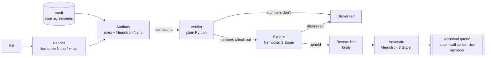

# Clerk

**The personal AI that audits your bills and fights back.**
Drop in a bill. Clerk checks every line against the agreements it remembers, puts each accusation on trial, and drafts the letter to get your money back. Nothing leaves without your approval.

Built for the **Nebius x NVIDIA Global AI Hackathon 2026** · Track: **Personal AI** · Powered by **NVIDIA Nemotron on Nebius Token Factory**

<!-- TODO before submitting: replace with your demo GIF and links -->
> **Live demo:** `https://<your-endpoint>` · **Video:** `https://youtu.be/<id>` · No login needed: click **"Try it with Maria's paperwork"**

---

## The problem

Companies bill you by machine, and the machines make mistakes: double charges, prices above the rate you signed for, fees your contract doesn't allow, add-ons you never ordered, totals that don't add up. Catching them means digging out the contract, checking every line, knowing your rights and writing a formal dispute before the deadline. Almost nobody does that, so the money stays lost.

## What Clerk does

| | |
|---|---|
| **Remembers** | Upload an agreement once. Clerk's **Vault** stores its terms (rate, lock date, included services, fee caps, dispute window) as facts you can see, edit, export and delete. |
| **Audits** | Upload a bill (text, PDF or, in live mode, a photo). Clerk matches it to the right agreement and checks every line. |
| **Puts every accusation on trial** | The **Tribunal**: rule-based Auditors and a Nemotron AI Auditor raise possible problems, plain Python **verifies** every number, and a Nemotron Super **Skeptic** cross-examines each one. False alarms are thrown out *before* you see them. |
| **Cites** | The **Researcher** pulls current, citable guidance for each upheld finding with Tavily. |
| **Acts, on a leash** | The **Advocate** drafts a dispute letter, a phone script and a calendar reminder for the deadline. Each one waits in an **approval queue**. |
| **Shows its work** | The **Trace** panel lists every model call: agent, model, tokens, latency and cost. |

### The Tribunal



**Design principle: the AI proposes, the code verifies.** A model may *suggest* that a charge is wrong, but every dollar amount shown to the user is recomputed by deterministic code from the actual bill lines. A model finding that cites a line that doesn't exist, or claims more than the line charges, is rejected or corrected before the Skeptic ever sees it.

## How we use Nebius and NVIDIA

| Component | Model / service | Why |
|---|---|---|
| Reader | **Nemotron Nano** on Token Factory (vision model for photos) | Fast, cheap structured extraction from messy documents |
| AI Auditor | **Nemotron Nano** | Open-ended "anything else wrong?" pass over the bill + agreement |
| Skeptic | **Nemotron 3 Super** (120B hybrid MoE, built for agents) | Careful reasoning: is there an innocent explanation? |
| Advocate | **Nemotron 3 Super** | Firm, factual dispute letters, with a guardrail that rejects any letter whose amounts don't match the verified total |
| Ask Clerk | **Nemotron Nano** | Answers questions from your Vault only |
| Vault search | NVIDIA embedding model (optional) | Semantic recall over remembered facts |
| Hosting | **Nebius Serverless Endpoint** (one container) | API + UI in a single image |

**Routing:** cheap steps run on Nano and judgement runs on Super. `make eval-ablation` measures what that saves against Super-only.
All calls go through Token Factory's OpenAI-compatible API (`api.tokenfactory.nebius.com/v1`), with retries, a per-day call budget and a per-workspace audit limit to protect credits.

## Results

Fifty synthetic statements with **planted errors whose answers are known**, plus **decoys**: legitimate charges that look wrong (installments, a fee within the cap, a price rise after a promotion ended, a renamed included service, one-cent tax rounding).

<!-- TODO: replace with the output of `make eval-live` (backend/evals/results/live.md) -->
| Stage | Precision | Recall | $ wrongly accused |
|---|---|---|---|
| Auditors only | _run `make eval-live`_ | | |
| + Verifier (code) | | | |
| + Skeptic (what users see) | | | |

The offline simulator run (`make eval`, in CI) is in [`backend/evals/results/offline.md`](backend/evals/results/offline.md). **It checks that the pipeline is wired correctly. It is not a measure of model quality.**

## Try it

### Hosted
Open the demo link and click **Try it with Maria's paperwork**. Maria has three agreements and three statements:

| Statement | What's wrong | Clerk should find |
|---|---|---|
| Northwind Fiber (internet) | Billed $69.99 against a $39.99 rate locked until 2027; unrequested "Premium Tech Support add-on"; a renamed but included router rental (decoy) | **$39.99** |
| Brightside Energy | Thermostat rental billed twice; $35 late fee against a $15 cap; total $10 higher than subtotal + tax | **$34.50** |
| Lakeview Apartments | Pet-deposit installments 1/2 and 2/2 (decoy); $40 late fee within the $50 cap (decoy) | **$0: "This bill checks out"** |

Every workspace is private to your browser (an anonymous cookie). **Forget everything** in the Vault tab erases it.

### Run locally
```bash
make setup                 # Python venv + npm install
cp .env.example .env       # add NEBIUS_API_KEY, model IDs (make models), optional TAVILY_API_KEY
make models                # list the Nemotron model IDs your key can use
make live-smoke            # one real end-to-end audit against Nebius
make dev                   # API :8000 + UI :5173
```
No keys yet? Leave `CLERK_MODE=offline` and everything runs on a deterministic simulator, clearly labelled in the UI as **not real model output**.

### Docker
```bash
make docker-build && make docker-run     # http://localhost:8000
```
Deploying to Nebius Serverless: see [`docs/DEPLOY_NEBIUS.md`](docs/DEPLOY_NEBIUS.md).

## Testing

| Layer | Command | What it covers |
|---|---|---|
| Unit + API (pytest, 83 tests, 95% coverage) | `make test` | parsing, every auditor, the Verifier, the Skeptic's verdict handling, JSON recovery from reasoning-model output, the Token Factory and Tavily request formats, retries and timeouts, budgets, every endpoint, upload limits, workspace isolation, path traversal |
| Browser end to end (Playwright, 13 tests) | `make e2e` | the full judge journey in Chromium: demo → trial → verdicts → approve → download → edit the Vault → re-audit → permissions → wipe → mobile layout |
| Eval | `make eval` / `make eval-live` | precision, recall and dollars over 50 synthetic bills |
| Static | `make lint` | ruff, mypy (strict), TypeScript (strict) |

## Project layout
```
backend/clerk/
  agents/      reader + ai auditor + skeptic + advocate (llm_agents.py), detectors.py, verifier.py,
               researcher.py, tribunal.py (orchestration), simulators.py (offline stand-ins)
  llm/         nebius.py (Token Factory client), offline.py, jsonutil.py
  search/      Tavily client
  vault.py     memory: facts + embeddings + search
  paperwork.py letters, call scripts, .ics reminders
  api.py       FastAPI + Server-Sent Events + static UI
  synth.py     synthetic bills with planted errors
backend/evals/ eval runner          backend/scripts/  list_models.py, live_smoke.py
frontend/      React + Vite + Tailwind UI, Playwright tests in e2e/
```

## Limits and honesty
- Clerk is not legal or financial advice. It flags likely billing errors and drafts letters **for you to check and send**.
- The Researcher returns no sources in offline mode rather than invented ones.
- Reading photos needs live mode (a Nemotron vision model). Scanned PDFs without a text layer should be uploaded as photos.
- Demo data is entirely synthetic.

## License
[Apache-2.0](LICENSE)
