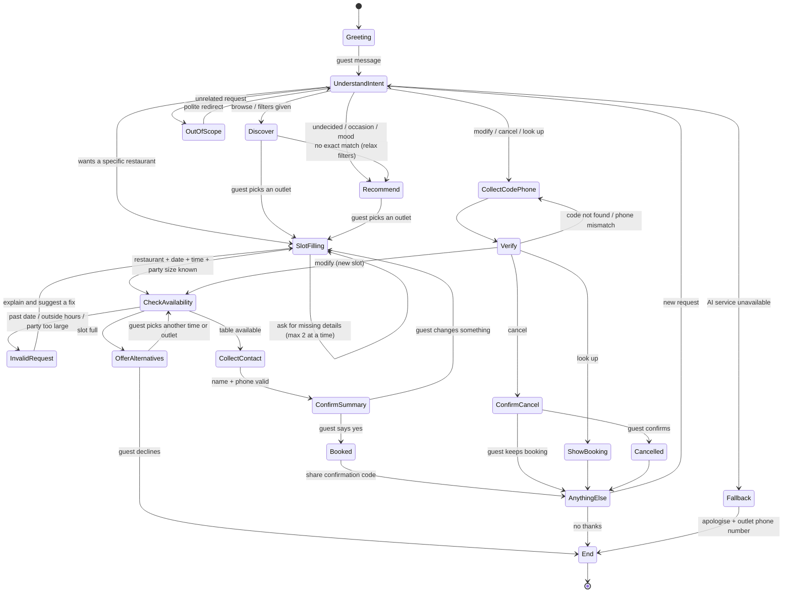

# Use Case: GoodFoods Reservation Agent

> Client: **GoodFoods**, a restaurant chain with 75 outlets across Bengaluru. Bot persona: **"Gia"**.
> All figures are planning assumptions, to be replaced by measurements from the first 2 weeks of the pilot.

---

# Goal

## Long Term Goal

Become the **default way guests reach GoodFoods**, so that every guest who wants to eat at GoodFoods gets a table at *some* GoodFoods outlet, in their language, on the channel they already use, within a minute.

In practice, over 12–18 months:
1. **Handle 70%+ of reservations** across web chat, WhatsApp and phone voice, freeing hosts to look after guests in the restaurant.
2. **Fill the chain, not just one outlet.** Overflow demand is routed to sister outlets and quieter time slots instead of being lost to competitors.
3. **Own the guest relationship.** Build first-party guest data (occasions, preferences, visit history) and reduce dependence on aggregators.
4. **Become a reusable platform** for any "capacity × time-slot" business (other restaurant chains, salons, clinics, hotels), with GoodFoods as the reference customer.

## Success Criteria

- What will make this bot successful

The bot is successful when guests prefer it to calling, hosts trust it, and the business sees more covers at lower cost.

| Dimension | Metric | Baseline (assumed) | Target at 6 months |
|---|---|---|---|
| **Guests prefer it** | Share of all reservations made through the bot | 0% | 40% |
| | Median time to complete a booking | ~4 min by phone | < 90 seconds |
| | Post-booking CSAT | n/a | ≥ 4.5 / 5 |
| **It gets the job done** | Conversations with booking intent that end in a confirmed booking | n/a | ≥ 65% |
| | "Fully booked" situations saved with another time or outlet | ~0% | ≥ 35% |
| | Conversations handed off to a human | n/a | < 10% |
| **Hosts trust it** | Bookings needing manual correction (wrong date, double booking) | n/a | < 1% |
| | Confirmation codes the bot made up without booking | n/a | 0 (blocked in code) |
| | Correct tool choice on the intent test set | n/a | ≥ 90% |
| **Business impact** | Host phone minutes per outlet per day | ~300 min | −50% |
| | No-show rate | 12% | 7% |
| | Weekday off-peak (before 7:30 pm) seat utilisation | ~45% | 55% |
| | Share of bookings via aggregators | ~30% | 20% |
| | AI cost per completed booking | n/a | < ₹2 |

---

# Use case

**Explain in a 100 words**

GoodFoods guests book mainly by phone, and calls peak exactly when hosts are busiest. Unanswered calls, outlets that can't see each other's tables, and no-shows all cost covers. Gia is a conversational reservation agent that understands requests like "somewhere quiet for our anniversary, Saturday 8pm, Indiranagar". It recommends suitable outlets with reasons, checks live seat availability, collects only the missing details, confirms before booking and issues a confirmation code. When a slot is full, it offers other times or a sister outlet nearby. Guests can also look up, change or cancel bookings. Business rules are enforced in code, so the AI cannot overbook.

## Key Steps (Bot flow)

What the guest experiences:

1. **Say what you want, in your own words.** "Table for 4 tomorrow at 8", "Any Italian place in Koramangala?", "Not sure where to go for a birthday" or "Cancel my booking" all work. No menus or forms.
2. **Get options, or a recommendation if you're undecided.** Up to 3 outlets, each with cuisine, area, price, rating and a one-line reason ("romantic ambience, rooftop, rated 4.9").
3. **Pick one and hear right away whether there's a table.** A real-time check for your date, time and party size.
4. **If it's full, you aren't turned away.** You get the nearest free times at the same outlet, or a sister outlet nearby that has a table.
5. **Give only what's missing.** The bot asks for at most two details at a time: name, phone, and date, time or party size if not yet given.
6. **Check the summary and say yes.** "4 guests, Tue 24 Nov at 20:00, Coastal Catch – Koramangala, under Ravi. Shall I confirm?"
7. **Get your confirmation code.** For example GF-K7P2Q, with the address. Special requests and occasions (birthday, high chair) are noted.
8. **Change or cancel any time.** Give the code and the phone number you booked with. A change is applied only if the new slot is free; otherwise your original booking stays.
9. **Stay in scope.** Off-topic questions are politely redirected. If the service has a problem, you get a friendly message instead of an error.

## State Transition Diagram

---

# Bot Features

## Key specifications that the customer cares about

**Difficulty:** 🟢 Green = straightforward · 🟡 Yellow = moderate, needs care · 🔴 Red = hard, depends on outside systems or research. **Status:** ✅ built in this submission · 🗺️ roadmap.

| Feature | Why the customer cares | Difficulty | Status |
|---|---|---|---|
| Natural-language booking (no forms) | Faster than calling; works at 11 pm | 🟢 | ✅ |
| Search by cuisine, area, price, features | Guests know what they want | 🟢 | ✅ |
| Recommendations with reasons (occasion → ambience) | Undecided guests convert; feels personal | 🟡 | ✅ |
| Live availability per 90-minute slot | No false promises; no double booking | 🟡 | ✅ |
| Alternatives when full (times + sister outlets) | Keeps the guest in the chain | 🟡 | ✅ |
| Confirm-before-booking + confirmation code | Trust; fewer wrong bookings | 🟢 | ✅ |
| Modify / cancel with phone verification | Self-service; prevents tampering | 🟢 | ✅ |
| Understands "tomorrow 8pm", "next Saturday", "Indira nagar" | Natural speech; fewer back-and-forths | 🟡 | ✅ |
| Guard against made-up confirmations | The bot never says "booked" unless it is | 🟡 | ✅ |
| Polite scope limits, prompt-injection resistance | Brand safety | 🟢 | ✅ |
| Host view of bookings and tool calls | Staff transparency | 🟢 | ✅ (demo UI) |
| WhatsApp channel | Where Indian guests already are | 🟡 | 🗺️ |
| Reminders + one-tap reconfirm / cancel | Cuts no-shows | 🟡 | 🗺️ |
| Waitlist with automatic backfill of cancellations | Fills released tables | 🟡 | 🗺️ |
| Occasion add-ons (cake, decor), group pre-orders | Extra revenue per booking | 🟡 | 🗺️ |
| Guest profiles and personalisation | Repeat visits, CRM | 🟡 | 🗺️ |
| Deposits for large parties at peak times | Protects peak revenue | 🔴 | 🗺️ |
| Table-level seating (2-tops, 4-tops, joining tables) | More accurate capacity | 🔴 | 🗺️ |
| Phone voice agent in Indic languages | Reaches guests who only call | 🔴 | 🗺️ |
| Live sync with POS / table-management system | Single source of truth | 🔴 | 🗺️ |

## KBs

| Knowledge base | Contents | Source / owner | Freshness |
|---|---|---|---|
| **Restaurant catalogue** | 75 outlets: name, area, address, cuisine, price tier, cost for two, rating, hours, seats, max online party size, features (parking, outdoor, vegan, private dining…), ambience | Operations | Weekly, or on change |
| **Booking policies** | 90-minute slots, 60-day booking window, 30-minute same-day notice, last seating 90 min before close, party limits, verification rules | Operations | Rarely changes; enforced in code |
| **Vocabulary mappings** | Occasion → ambience (anniversary → romantic, quiet); synonyms → features ("terrace" → outdoor seating, "veg" → vegetarian friendly) | Product | As guest language is observed |
| **Live inventory** | Confirmed reservations per outlet and slot | Reservation database (later the POS) | Real time, read through tools, never cached in the prompt |
| *Roadmap:* menus, dress code, FAQs | Signature dishes, Jain options, kids menu, parking details | Marketing | Monthly |

Static facts come from structured data through tools, not from documents pasted into the prompt. This keeps the 8B model's context small and the answers accurate.

## Does it need Tools?

**Yes, and they are central.** The LLM chooses tools by intent; all actions and rules live in tools served over **MCP (Model Context Protocol)**:

| Tool | Purpose |
|---|---|
| `list_options` | What cuisines, areas and features exist |
| `search_restaurants` | Filtered list |
| `recommend_restaurants` | Top 3 with reasons; optional live availability filter |
| `get_restaurant_details` | Hours, address, phone, features |
| `check_availability` | Free seats for a slot, or alternative times and outlets |
| `make_reservation` | Atomic booking, returns a code |
| `get_reservation` | Look up by code |
| `modify_reservation` | Change date, time, size or requests (verified) |
| `cancel_reservation` | Cancel (verified) |

Roadmap tools: `send_reminder`, `join_waitlist`, `add_occasion_package`, `request_deposit`, `handoff_to_host`.

## Which Languages

| Phase | Languages | Notes |
|---|---|---|
| v1 (built) | **English**, including Indian English and Indian names | Works with Llama 3.1 8B |
| v2 | **Hindi, Kannada** and code-mixed (Hinglish, Kanglish) | Text on WhatsApp first; needs an Indic-capable model or translation layer |
| v3 | **Tamil, Telugu**; **voice** in all of the above | Speech-to-text and text-to-speech tuned for Indian names, numbers and dates; read back phone numbers digit by digit |

## Any new features asked for?

The brief asks for **recommendations**, **50–100 locations with varying capacity and cuisine**, **LLM-decided intent with tool calling over a modern protocol**, and **no agent frameworks**. All are delivered. Features I've added beyond the brief, because they address real business problems:
- **Cross-outlet alternatives** when a slot is full (keeps demand in the chain)
- **Phone verification** for changes and cancellations (security)
- **Blocking of made-up confirmation codes** (trust)
- **Understanding natural dates, times and spellings** (fewer failed turns)
- **Restaurant browser and tool-call viewer** in the UI (transparency for staff and reviewers)

## What integrations are needed

| Integration | Purpose | Difficulty | Phase |
|---|---|---|---|
| LLM provider (Groq / Together / self-hosted vLLM) via OpenAI-compatible API | Understanding and replies | 🟢 | ✅ v1 |
| MCP tool server ↔ reservation database | Single place where rules are enforced | 🟢 | ✅ v1 |
| Website widget (Streamlit now, embeddable chat later) | Guest access | 🟢 | ✅ v1 |
| POS / table-management system (e.g. the system hosts use today) | Shared live inventory with walk-ins and phone bookings | 🔴 | v2 |
| Aggregator inventory sync | Avoid double booking across channels | 🔴 | v2 |
| WhatsApp Business API | Channel, reminders, reconfirmation | 🟡 | v2 |
| SMS gateway | Confirmation codes for guests not on WhatsApp | 🟢 | v2 |
| CRM / customer data platform | Guest profiles, campaigns | 🟡 | v2 |
| Payment gateway (UPI) | Deposits, prepaid add-ons | 🟡 | v3 |
| Telephony + Indic speech stack | Voice agent | 🔴 | v3 |
| Analytics (events → dashboard) | KPIs, A/B tests | 🟢 | v2 |
| Host escalation (staff app or WhatsApp group) | Human handoff | 🟢 | v2 |

---

# Scale up / Rollout Strategy

- What would be a reasonable way to test and roll this out?

| Stage | Weeks | What happens | Gate to move on |
|---|---|---|---|
| **0. Offline testing** | 0–4 | Unit tests on every rule (102 automated tests in this repo). An intent test set of real guest phrasings collected from call recordings. Red-team for injection and out-of-scope requests | Intent accuracy ≥ 90%; zero rule violations |
| **1. Shadow mode** | 5–6 | At 3 pilot outlets, hosts type incoming phone requests into the bot. The bot proposes the action; the host decides. Measure where they differ | ≥ 95% agreement with hosts on bookable requests |
| **2. Pilot** | 7–10 | Live on the website for 3 outlets (one small, one large, one with private dining). Every booking appears on the host view; one-click human override; daily review of failed conversations | < 1% booking errors; CSAT ≥ 4.3; conversion ≥ 55% |
| **3. Expand** | 11–14 | 15 outlets; launch WhatsApp, reminders and waitlist. A/B test the prompt and recommendation weights | No-show rate falling; recovery ≥ 25% |
| **4. Chain-wide** | 15–24 | All 75 outlets; cross-outlet routing at full strength; Kannada and Hindi text, then a voice pilot | 40% of bookings through the bot |

**Safety nets throughout:**
- Feature flag per outlet, and a kill switch that falls back to "please call the outlet".
- Rules enforced in code, independent of the model.
- Every conversation is logged with its tool calls and timings. Weekly review of failures feeds new test cases.
- Model and prompt versions are pinned; any change must pass the intent test set before release.
- Human handoff whenever the bot fails twice in a row, or when the guest asks for a person.

---

# Key Challenges

- what are the key challenges that you think you will face

| Challenge | Why it's hard | How it's addressed |
|---|---|---|
| **Small-model reliability** | 8B models pick the wrong tool, pass malformed arguments, write tool calls as text or invent details | Rules enforced in tools; structured errors the model can recover from; parsing of tool calls written as text; a 6-step limit; made-up confirmation codes blocked; intent test set run before each release |
| **One inventory across channels** | Phone, walk-ins, aggregators and the bot all draw on the same seats; double booking destroys trust | Atomic check-and-book transactions now; integration with the POS / table-management system as the single source of truth before scaling |
| **Ambiguous dates and times** | "8" (am or pm?), "this Friday" said on a Friday, guests in other timezones | Today's date given to the model every turn; rules for reading times; read-back before booking; out-of-hours hints ("did you mean 20:00?") |
| **Capacity model versus real tables** | Pooled seats ignore table shapes; a party of 5 may need two joined tables | v1 uses a conservative seat pool; v2 adds table-level seating rules from operations |
| **Indic languages and voice** | Code-mixing, accents, names and phone numbers misheard by speech-to-text | Text first; speech models tuned for Indian names; digit-by-digit read-back; confirmation step |
| **Host adoption** | Staff may see the bot as a threat or not trust its bookings | Hosts keep override rights and a live booking view; show them the hours saved; recruit champions at pilot outlets |
| **No-shows from frictionless booking** | Easy booking can mean careless booking | Reminders with reconfirmation, duplicate detection, deposits for large parties at peak |
| **Privacy and compliance (India's DPDP Act 2023)** | Names and phone numbers are personal data | Collect the minimum; mask phone numbers in replies; consent notice; retention limits; changes require phone verification |
| **Latency and cost at scale** | Several model calls per turn; peak-hour traffic | Fast 8B inference (≈ ₹0.1 per conversation); compact tool outputs; history trimming; provider-agnostic, so the provider can be switched |
| **Measuring true impact** | Did the bot create a booking, or move one from the phone? | Shadow-mode baselines; outlet-level A/B tests; track recovered "full" situations separately |

---

# Additional business analysis

## Business opportunities beyond "taking bookings"

1. **Cross-outlet demand routing.** Only a chain can say "Koramangala is full, Indiranagar has a table 10 minutes away." Aggregators send this demand to competitors.
2. **Off-peak demand shaping.** Suggest 7:00 instead of 8:00, or Tuesday instead of Saturday, optionally with an incentive.
3. **No-show reduction.** Reminders, reconfirmation, waitlist backfill, deposits.
4. **First-party guest CRM.** Occasions, dietary needs and favourite outlets, used for campaigns without aggregator fees.
5. **Occasion upsell at booking.** Cake, decorations, group pre-orders.
6. **Event leads.** Groups above online limits routed to private dining.
7. **Forecasting.** Booking curves feed staffing and purchasing, reducing labour cost and food waste.
8. **Language access.** Kannada, Hindi, Tamil and Telugu speakers served by voice.

## Key stakeholders

| Stakeholder | Interest | Role |
|---|---|---|
| Diners | Fast, accurate booking in their language | End users |
| Hosts and floor managers | Fewer calls at peak; reliable covers | Daily users; escalation point |
| Head of Guest Experience | NPS, consistency | **Business owner** |
| COO / Operations | Utilisation, staffing | Sponsor; owns capacity rules |
| Marketing / CRM | Guest data, campaigns, lower aggregator spend | Data consumer; owns upsell offers |
| CFO / Finance | ROI | Approves budget; tracks benefits |
| IT | POS integration, security | Integration owner |
| Legal | DPDP compliance | Signs off on data handling |

## ROI estimate (illustrative, 75 outlets)

**Assumptions:** 60 reservations per outlet per day, 3 guests per booking, ₹700 average spend per guest, 55% contribution margin on extra covers, host cost ₹250 per hour.

| Lever | Logic | Annual value |
|---|---|---|
| Staff time | 3.15 h saved per outlet per day × ₹250 × 75 × 365 | ₹2.2 Cr |
| Recovered missed demand | 2 bookings per outlet per day × 3 × ₹700 × 75 × 365 = ₹11.5 Cr revenue | ₹6.3 Cr contribution |
| No-show reduction | 1.5 re-filled bookings per day × 3 × ₹700 × 75 × 365 = ₹8.6 Cr revenue | ₹4.7 Cr contribution |
| Aggregator fees | 6 bookings per outlet per day moved off aggregators × 3 guests × ₹40 × 75 × 365 | ₹2.0 Cr |
| Upsell | 3 add-ons per outlet per day × ₹600 × 75 × 365 × 50% margin | ₹2.5 Cr |
| **Total** | | **≈ ₹17.7 Cr per year** |

**Cost:** ≈ ₹50 L to build and integrate, plus ≈ ₹20 L per year to run. Even the two most conservative levers alone (≈ ₹4.1 Cr) give more than 5× ROI in year 1.

## Vertical expansion

The core abstraction is **resource capacity × time slot × rules**. The agent loop, MCP layer, test harness and UI are reused; only the tools and persona change.

| Vertical | Resource / slot | Example extra tool |
|---|---|---|
| Other restaurant chains (white-label) | Tables | `pre_order_menu` |
| QSR / cloud kitchens | Pickup slots | `schedule_pickup` |
| Hotels | Rooms, spa, F&B outlets | `quote_rate` |
| Salons and spas | Stylist × chair × service duration | `book_with_stylist` |
| Clinics and diagnostics | Doctor or test slots | `send_prep_instructions` |
| Fitness studios | Class capacity | `join_waitlist` |
| Coworking spaces | Meeting rooms × hours | `invoice_company` |
| Banquet halls | Venue × date | `generate_quote` |

**Potential customers:** mid-size Indian restaurant chains (10–200 outlets) that are unhappy with aggregator fees, hotel groups with several F&B outlets, salon chains and diagnostic-lab chains.

## Competitive advantages

1. **Chain-aware routing.** Overflow demand stays inside the brand. Aggregators have no reason to do this, and single-restaurant tools can't.
2. **Fit for India at small-model cost.** An 8B model costs a fraction of a rupee per conversation, can run on sovereign or on-prem infrastructure, and has a clear path to Indic voice and WhatsApp.
3. **Trustworthy and vendor-neutral.** Deterministic rules plus the open MCP protocol mean the model can't overbook, and the same agent can connect to any POS or switch to a better model without a rewrite.

## Assumptions, limitations, future work

- **Assumptions:** seats pooled per 90-minute slot; one city and timezone; synthetic outlet data; guests identified by phone; all financial figures to be confirmed in the pilot.
- **Limitations:** no table-level seating; English only; SQLite (single node); demo UI rather than an embeddable widget.
- **Future work:** see the 🗺️ items in Bot Features and stages 3–4 of the rollout.
